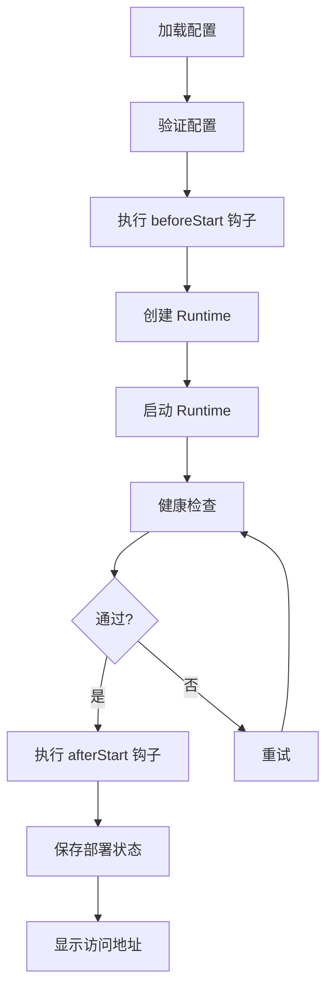

# 🚀 DSH 统一部署配置系统

## 概览

通过**一个配置文件 + 一个启动命令**，实现 DSH 及其功能集合的标准化部署。

```bash
# 创建配置文件
cat > my-deployment.json << 'EOF'
{
  "name": "ppt-prod",
  "version": "1.0.0",
  "deployment": {
    "type": "domain",
    "source": "./bridges/ppt-bridge/domains/ppt"
  }
}
EOF

# 一键部署
node packages/dsh-suite-kit/bin/dsh-deploy.mjs start my-deployment.json

# ✅ 完成！访问 http://127.0.0.1:3080/
```

---

## 📁 文件结构

```
packages/dsh-suite-kit/
├── deployment.schema.json           # 配置文件 JSON Schema
├── bin/dsh-deploy.mjs              # 统一启动器（核心）
├── examples/                        # 配置示例
│   ├── deployment-ppt-basic.json   # 基础 PPT 部署
│   ├── deployment-ppt-dev.json     # 开发环境部署
│   └── deployment-multi-service.json  # 多服务组合
└── DEPLOYMENT.md                    # 完整文档
```

---

## 🎯 核心优势

### 1. **配置即代码**
- ✅ 配置文件可版本控制（Git）
- ✅ 声明式描述，清晰易读
- ✅ JSON Schema 校验 + VSCode 自动补全

### 2. **标准化流程**
```
配置文件 → 验证 → 创建 Runtime → 启动 → 健康检查 → 保存状态
```

### 3. **生命周期管理**
- 启动前/后钩子 (`beforeStart`, `afterStart`)
- 停止前/后钩子 (`beforeStop`, `afterStop`)
- 自动健康检查（重试机制）
- 部署状态追踪

### 4. **环境隔离**
- 每个部署独立的 Runtime
- 独立的端口、存储、进程树
- 支持多环境配置（dev/staging/prod）

---

## 🚀 快速开始

### 步骤 1: 创建配置

```json
{
  "$schema": "./deployment.schema.json",
  "name": "my-ppt",
  "version": "1.0.0",
  "title": "我的 PPT 工作台",
  
  "deployment": {
    "type": "domain",
    "source": "./bridges/ppt-bridge/domains/ppt",
    "autoStart": true
  },
  
  "runtime": {
    "ports": {
      "harness": 3082,
      "content": 39312
    }
  },
  
  "launcher": {
    "mode": "background",
    "healthCheck": {
      "enabled": true,
      "interval": 30,
      "retries": 3
    }
  }
}
```

### 步骤 2: 验证配置

```bash
node packages/dsh-suite-kit/bin/dsh-deploy.mjs validate my-ppt.json
```

### 步骤 3: 启动部署

```bash
node packages/dsh-suite-kit/bin/dsh-deploy.mjs start my-ppt.json
```

输出：
```
🚀 部署启动: 我的 PPT 工作台
配置: my-ppt.json
Runtime ID: rt-my-ppt-100

创建 runtime: rt-my-ppt-100
✓ Runtime 创建成功: rt-my-ppt-100

启动 runtime: rt-my-ppt-100
✓ Runtime 启动成功 (pid 123456)

健康检查...
  Harness: http://127.0.0.1:3082/
  Content: http://127.0.0.1:39312/
  ✓ 健康检查通过

✅ 部署成功完成！

Harness: http://127.0.0.1:3082/
Content: http://127.0.0.1:39312/
```

---

## 📋 命令参考

| 命令 | 说明 | 示例 |
|---|---|---|
| `start` | 创建并启动部署 | `dsh-deploy start config.json` |
| `stop` | 停止部署 | `dsh-deploy stop config.json` |
| `restart` | 重启部署 | `dsh-deploy restart config.json` |
| `status` | 查看部署状态 | `dsh-deploy status config.json` |
| `validate` | 验证配置文件 | `dsh-deploy validate config.json` |
| `list` | 列出所有部署 | `dsh-deploy list` |
| `clean` | 停止并删除部署 | `dsh-deploy clean config.json` |

---

## 📝 配置文件详解

### 必需字段

```json
{
  "name": "部署名称（唯一标识）",
  "version": "1.0.0",
  "deployment": {
    "type": "domain | suite | custom",
    "source": "源路径"
  }
}
```

### 运行时配置 (可选)

```json
{
  "runtime": {
    "driver": "node",              // 隔离驱动
    "workId": "main",              // 工作区 ID
    "ports": {
      "harness": 3082,             // 固定端口
      "content": {                 // 或自动分配
        "preferred": 39312,
        "range": 100
      }
    },
    "model": { /* AI 模型配置 */ },
    "env": { /* 环境变量 */ }
  }
}
```

### 启动器配置 (可选)

```json
{
  "launcher": {
    "mode": "background",          // foreground | background | service
    "logFile": "runtime.log",
    "healthCheck": {
      "enabled": true,
      "interval": 30,
      "timeout": 10,
      "retries": 3
    },
    "beforeStart": ["echo 'Preparing...'"],
    "afterStart": ["echo 'Started'"]
  }
}
```

### 元数据 (可选)

```json
{
  "metadata": {
    "owner": "admin",
    "environment": "production",   // development | staging | production
    "tags": ["ppt", "stable"],
    "notes": "生产环境部署"
  }
}
```

---

## 🌟 配置示例

### 示例 1: 基础部署（最小配置）

```json
{
  "name": "ppt-basic",
  "version": "1.0.0",
  "deployment": {
    "type": "domain",
    "source": "./bridges/ppt-bridge/domains/ppt"
  }
}
```

### 示例 2: 开发环境（前台 + 调试）

```json
{
  "name": "ppt-dev",
  "version": "1.0.0",
  "deployment": {
    "type": "domain",
    "source": "./bridges/ppt-bridge/domains/ppt",
    "autoRestart": true
  },
  "runtime": {
    "workId": "dev",
    "env": {
      "NODE_ENV": "development",
      "DEBUG": "dsh:*"
    }
  },
  "launcher": {
    "mode": "foreground",
    "healthCheck": {
      "interval": 10,
      "retries": 1
    }
  },
  "metadata": {
    "environment": "development"
  }
}
```

### 示例 3: 生产环境（完整配置）

```json
{
  "name": "ppt-prod",
  "version": "1.0.0",
  "title": "PPT 工作台 - 生产环境",
  "deployment": {
    "type": "domain",
    "source": "./bridges/ppt-bridge/domains/ppt",
    "autoStart": true
  },
  "runtime": {
    "ports": {
      "harness": { "preferred": 3080, "range": 100 },
      "content": { "preferred": 39311, "range": 100 }
    },
    "model": {
      "id": "llm-deepseek",
      "plugin": "@deepseek-ai/dsh-llm-deepseek-api-key",
      "apiKeyEnv": "DEEPSEEK_API_KEY"
    }
  },
  "launcher": {
    "mode": "background",
    "healthCheck": {
      "enabled": true,
      "interval": 30,
      "timeout": 10,
      "retries": 3
    },
    "beforeStart": [
      "node scripts/check-deps.mjs",
      "node scripts/backup-state.mjs"
    ],
    "afterStart": [
      "node scripts/notify-ready.mjs"
    ]
  },
  "metadata": {
    "owner": "ops-team",
    "environment": "production",
    "tags": ["ppt", "stable", "v2"]
  }
}
```

---

## 🔄 工作流程

### 启动流程



### 部署状态

部署状态保存在 `~/.dsh-store/deployments/<name>.json`：

```json
{
  "name": "ppt-prod",
  "version": "1.0.0",
  "runtimeId": "rt-ppt-prod-100",
  "configPath": "/path/to/config.json",
  "status": "running",
  "createdAt": "2024-10-31T12:00:00.000Z",
  "updatedAt": "2024-10-31T12:05:00.000Z"
}
```

---

## 🎨 高级用法

### 1. 多环境管理

```bash
deployments/
├── ppt-dev.json          # 开发: 前台 + 调试日志
├── ppt-staging.json      # 测试: 后台 + 健康检查
└── ppt-prod.json         # 生产: 后台 + 监控 + 钩子
```

```bash
# 快速切换环境
dsh-deploy stop deployments/ppt-dev.json
dsh-deploy start deployments/ppt-prod.json
```

### 2. 批量部署

```bash
#!/bin/bash
for env in dev staging prod; do
  echo "部署 $env 环境..."
  dsh-deploy start "deployments/ppt-$env.json"
done
```

### 3. 钩子变量

钩子中可用变量：
- `${runtimeId}`: Runtime ID
- `${configPath}`: 配置文件路径
- `${configDir}`: 配置文件目录

```json
{
  "launcher": {
    "afterStart": [
      "echo 'Runtime ${runtimeId} 已启动'",
      "node ${configDir}/scripts/post-deploy.mjs ${runtimeId}"
    ]
  }
}
```

### 4. CI/CD 集成

```yaml
# GitHub Actions
deploy:
  steps:
    - name: Validate Config
      run: dsh-deploy validate deploy-prod.json
    
    - name: Deploy
      run: dsh-deploy start deploy-prod.json
    
    - name: Health Check
      run: dsh-deploy status deploy-prod.json
```

---

## 📊 与旧方式对比

| 特性 | 手动命令 | dsh-runtime | **dsh-deploy** ⭐ |
|---|---|---|---|
| **配置管理** | 分散的命令 | 命令行参数 | ✅ 统一配置文件 |
| **可版本化** | ❌ | ❌ | ✅ Git 友好 |
| **钩子支持** | ❌ | ❌ | ✅ 4 个钩子点 |
| **健康检查** | 手动 | ❌ | ✅ 自动 + 重试 |
| **状态追踪** | ❌ | runtime.json | ✅ 部署状态文件 |
| **多环境** | 难管理 | 需记忆参数 | ✅ 独立配置文件 |
| **Schema 验证** | ❌ | ❌ | ✅ JSON Schema |
| **IDE 支持** | ❌ | ❌ | ✅ VSCode 自动补全 |

---

## 🛠️ 故障排查

### 问题 1: 部署失败

```bash
# 1. 验证配置
dsh-deploy validate config.json

# 2. 查看详细状态
dsh-deploy status config.json

# 3. 检查源路径
ls -la $(jq -r '.deployment.source' config.json)

# 4. 手动测试
node packages/dsh-suite-kit/bin/dsh-domain.mjs validate <source>
```

### 问题 2: 健康检查失败

```bash
# 1. 手动检查端口
curl http://127.0.0.1:39312/healthz

# 2. 查看 runtime 状态
node packages/dsh-suite-kit/bin/dsh-runtime.mjs doctor <runtime-id>

# 3. 查看日志
cat ~/.dsh-store/runtimes/<runtime-id>/logs/runtime.log
```

### 问题 3: 端口冲突

```bash
# 1. 使用端口范围自动分配
{
  "runtime": {
    "ports": {
      "harness": { "preferred": 3080, "range": 100 }
    }
  }
}

# 2. 或手动指定其他端口
{
  "runtime": {
    "ports": {
      "harness": 3090,
      "content": 39320
    }
  }
}
```

---

## 📚 完整文档

- **详细文档**: [DEPLOYMENT.md](./DEPLOYMENT.md)
- **配置 Schema**: [deployment.schema.json](./deployment.schema.json)
- **配置示例**: [examples/](./examples/)
- **Domain 规范**: [README.md](./README.md)

---

## 🎉 总结

### 使用前

```bash
# 需要记忆复杂的命令和参数
node packages/dsh-suite-kit/bin/dsh-runtime.mjs create \
  --name my-runtime \
  --domain ./bridges/ppt-bridge/domains/ppt \
  --store-root ~/.dsh-store

node packages/dsh-suite-kit/bin/dsh-runtime.mjs start rt-my-runtime-xxx

# 需要手动检查健康状态
curl http://127.0.0.1:39312/healthz

# 配置分散，难以管理
```

### 使用后

```bash
# 1. 创建配置（一次性，可版本控制）
cat > my-ppt.json << 'EOF'
{
  "name": "my-ppt",
  "version": "1.0.0",
  "deployment": {
    "type": "domain",
    "source": "./bridges/ppt-bridge/domains/ppt"
  }
}
EOF

# 2. 一键部署（自动健康检查 + 状态追踪）
dsh-deploy start my-ppt.json

# 3. 轻松管理
dsh-deploy status my-ppt.json
dsh-deploy restart my-ppt.json
dsh-deploy list
```

---

**🚀 现在就试试！**

```bash
# 验证示例配置
node packages/dsh-suite-kit/bin/dsh-deploy.mjs validate \
  packages/dsh-suite-kit/examples/deployment-ppt-basic.json

# 启动！
node packages/dsh-suite-kit/bin/dsh-deploy.mjs start \
  packages/dsh-suite-kit/examples/deployment-ppt-basic.json
```
